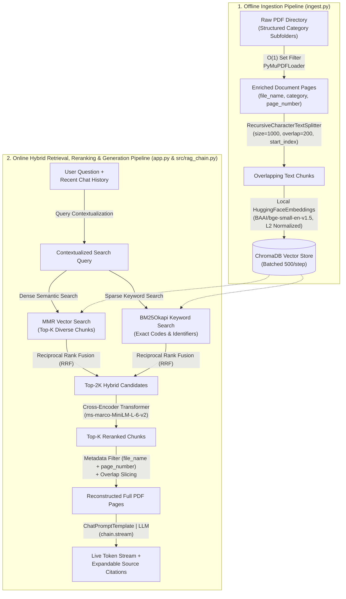

# Technical Document RAG Assistant (Hybrid Search + Cross-Encoder Reranking + Full-Page Expansion)

A domain-agnostic, production-engineered **Retrieval-Augmented Generation (RAG)** system built with **LangChain**, **ChromaDB**, **HuggingFace (`BAAI/bge-small-en-v1.5`)**, **BM25 (`rank-bm25`)**, **Cross-Encoder Reranking (`cross-encoder/ms-marco-MiniLM-L-6-v2`)**, and **Google Gemini 3.8 Flash / OpenAI**.

Designed to scale across hundreds of PDFs and thousands of pages of complex technical manuals, legal/compliance documents, engineering specifications, or research papers, this architecture works out-of-the-box on any structured directory of PDF documents while automatically preserving folder hierarchies as filterable category metadata.

---

## System Architecture & Pipeline Workflow

The system is decoupled into two independent pipelines:
1. **Offline Ingestion Pipeline (`ingest.py`)**: Scans the target document directory, filters out excluded/duplicate folders in $O(1)$ time, extracts page text and category metadata via `PyMuPDF`, splits pages into overlapping chunks with exact character start indices, embeds chunks locally using `BAAI/bge-small-en-v1.5`, and persists them to ChromaDB in SQLite-safe batches.
2. **Online Multi-Stage Retrieval & Generation Pipeline (`app.py` $\rightarrow$ `src/rag_chain.py`)**:
   - **Stage 1 (Candidate Retrieval)**: Combines **Dense Vector Search (MMR)** and **Sparse Keyword Search (BM25)** via **Reciprocal Rank Fusion (RRF)** to select the top $2k$ candidate chunks.
   - **Stage 2 (Neural Reranking)**: Scores all $2k$ `(query, chunk)` pairs jointly through a **Cross-Encoder Transformer** (`ms-marco-MiniLM-L-6-v2`) to select the top $k$ highest-relevance chunks.
   - **Stage 3 (Full-Page Context Reconstruction & Streaming)**: Reconstructs full PDF pages seamlessly without overlap duplication, and streams grounded, page-cited answers in real time.



---

## Mathematical Foundations of the Retrieval Pipeline

### 1. L2 Vector Normalization & Cosine Similarity (`src/vector_store.py`)
Each text chunk is mapped to a $d = 384$-dimensional dense vector $\mathbf{v} \in \mathbb{R}^{384}$ using `BAAI/bge-small-en-v1.5`. By setting `encode_kwargs={"normalize_embeddings": True}`, every vector is L2-normalized to unit length $\lVert\mathbf{v}\rVert_2 = 1$:

$$
\hat{\mathbf{v}} = \frac{\mathbf{v}}{\lVert\mathbf{v}\rVert_2} = \frac{\mathbf{v}}{\sqrt{\sum_{i=1}^{d} v_i^2}}
$$

Because both the query vector $\hat{\mathbf{q}}$ and document vectors $\hat{\mathbf{d}}$ have unit norm, **Cosine Similarity** reduces to a fast hardware-accelerated dot product:

$$
\text{sim}(\hat{\mathbf{q}}, \hat{\mathbf{d}}) = \cos(\theta) = \frac{\hat{\mathbf{q}} \cdot \hat{\mathbf{d}}}{\lVert\hat{\mathbf{q}}\rVert_2 \, \lVert\hat{\mathbf{d}}\rVert_2} = \hat{\mathbf{q}} \cdot \hat{\mathbf{d}} = \sum_{i=1}^{384} \hat{q}_i \hat{d}_i
$$

---

### 2. Maximal Marginal Relevance — MMR (`src/rag_chain.py`)
Standard top-k similarity search often retrieves near-identical chunks from the same repetitive document. To maximize both **relevance** to the query $Q$ and **diversity** across documents, our vector retriever uses **Maximal Marginal Relevance (MMR)**.

First, it fetches a candidate pool $C$ of size `fetch_k` $= 3k$ chunks. Then it iteratively selects $k$ chunks into the selected set $S$ according to:

$$
\text{MMR} = \arg\max_{d_i \in C \setminus S} \left[ \lambda \, \text{sim}(d_i, Q) - (1 - \lambda) \max_{d_j \in S} \text{sim}(d_i, d_j) \right]
$$

* $\text{sim}(d_i, Q)$ rewards high semantic similarity to the user's question.
* $\max_{d_j \in S} \text{sim}(d_i, d_j)$ penalizes candidates that are redundant with chunks already selected in $S$.

---

### 3. Sparse Keyword Scoring via Okapi BM25 (`src/rag_chain.py`)
While dense embeddings capture conceptual meaning, they can wash out exact technical identifiers, part numbers, or section codes (e.g., `"ISO-9001"`, `"Section 4.2.1"`, `"Form-1040"`). We pair dense retrieval with **Okapi BM25** (`BM25Okapi`), which scores a document chunk $D$ for a tokenized query $Q = (q_1, q_2, \dots, q_n)$ as:

$$
\text{BM25}(D, Q) = \sum_{i=1}^{n} \text{IDF}(q_i) \cdot \frac{f(q_i, D) \cdot (k_1 + 1)}{f(q_i, D) + k_1 \cdot \left(1 - b + b \cdot \frac{|D|}{\text{avgdl}}\right)}
$$

where:
* $f(q_i, D)$ is the term frequency of token $q_i$ in chunk $D$.
* $|D|$ is the token length of chunk $D$, and $\text{avgdl}$ is the average chunk length across the corpus.
* $k_1 \approx 1.5$ controls term-frequency saturation, and $b \approx 0.75$ normalizes for document length.
* $\text{IDF}(q_i) = \ln\left(1 + \frac{N - n(q_i) + 0.5}{n(q_i) + 0.5}\right)$ is the **Inverse Document Frequency**, which assigns high weight to rare technical terms and near-zero weight to common stop words.

---

### 4. Hybrid Merging via Reciprocal Rank Fusion — RRF (`src/rag_chain.py`)
Cosine similarity scores in $[-1, 1]$ and unbounded BM25 scores in $[0, \infty)$ live on incompatible numerical scales and cannot be summed directly. We merge the ranked lists from MMR Vector Search ($R_{\text{vec}}$) and BM25 Keyword Search ($R_{\text{bm25}}$) using **Reciprocal Rank Fusion (RRF)**:

$$
\text{RRF}(d) = \sum_{m \in \lbrace\text{vec},\, \text{bm25}\rbrace} \frac{1}{\eta + \text{rank}_m(d)}
$$

where $\eta = 60$ is the standard RRF smoothing constant and $\text{rank}_m(d) \in [0, k-1]$ is the chunk's 0-based rank in retriever $m$.
* Chunks that rank highly in **both** semantic meaning (MMR) and exact keyword matching (BM25) receive contributions from both terms and rise to the top of the candidate pool $C_{\text{RRF}}$ (of size $2k$).

---

### 5. Stage 2 Neural Reranking via Cross-Encoder (`rerank_documents`)
Embedding models (bi-encoders) encode the question and document chunks *separately* into vectors, which makes them fast for searching thousands of chunks but can miss subtle context between the question and the passage.

Once Hybrid RRF narrows the corpus down to the top `2 * k` candidates, we pass those `[query, chunk_text]` pairs together through a **Cross-Encoder** (`cross-encoder/ms-marco-MiniLM-L-6-v2`), which reads the question and chunk side-by-side to predict a direct relevance score and keeps the top `k` winners:

```python
pairs = [[query, doc.page_content] for doc in docs]
scores = reranker.predict(pairs)
scored_docs = sorted(zip(scores, docs), key=lambda item: item[0], reverse=True)
return [doc for _, doc in scored_docs[:top_k]]
```

---

### 6. Seamless Full-Page Context Expansion (`expand_to_full_pages`)
Technical specifications and tables frequently span an entire page (3,000+ characters). Retrieving isolated 1,000-character chunks can cut off bulleted lists mid-way.

For every top-k reranked chunk, we query ChromaDB's metadata index (`file_name` and `page_number`) to fetch **all chunks belonging to that page**, sort them in top-to-bottom reading order by `start_index`, and slice off the 200-character `CHUNK_OVERLAP` seam so sentences aren't repeated where chunks meet:

```python
full_page_text = ""
for text, meta in pairs:
    start_idx = meta.get("start_index", 0)
    if not full_page_text:
        full_page_text = text
    else:
        overlap = max(0, len(full_page_text) - start_idx)
        full_page_text += text[overlap:]
```
This reconstructs the **exact original PDF page** cleanly before sending the context to the LLM.

---

## Key Software Engineering & Python Patterns Used

### 1. `@lru_cache(maxsize=1)` Singleton Caching Decorator
In `src/vector_store.py` and `src/rag_chain.py`, we decorate expensive initialization functions with `@lru_cache(maxsize=1)` from Python's `functools`:
```python
@lru_cache(maxsize=1)
def get_embedding_model(model_name: str = EMBEDDING_MODEL_NAME) -> HuggingFaceEmbeddings:
    ...

@lru_cache(maxsize=1)
def get_vector_store() -> Chroma:
    ...

@lru_cache(maxsize=1)
def get_bm25_corpus() -> List[Document]:
    ...

@lru_cache(maxsize=1)
def get_reranker(model_name: str = RERANKER_MODEL_NAME) -> CrossEncoder:
    ...
```
* **Why?** Without `@lru_cache`, every user question in Streamlit would re-initialize `HuggingFaceEmbeddings` (reloading 133 MB / 199 neural network layers from disk) and reload all document chunks from SQLite, adding ~6.5 seconds of overhead per turn.
* **How it works:** `@lru_cache(maxsize=1)` memoizes the return value in RAM on the first call. Every subsequent call returns the cached object in $< 0.001\text{s}$ (a thread-safe Singleton pattern).

### 2. Local-First Embedding Loading with Automatic Cloud Fallback
In `get_embedding_model()`, we attempt `model_kwargs={"local_files_only": True}` inside a `try / except` block:
* If the model is already cached locally, it loads in milliseconds with **zero network requests** to HuggingFace Hub.
* If the repository is cloned onto a fresh machine where the model is not yet cached, the `except` block automatically falls back to downloading and caching `BAAI/bge-small-en-v1.5`.

### 3. $O(1)$ Set Intersection for Duplicate Directory Filtering
In `src/document_loader.py`, we filter out duplicate backup folders (`EXCLUDED_DIRS`) using Python set intersection (`__and__`):
```python
def should_skip_path(file_path: Path) -> bool:
    return bool(set(file_path.parts) & EXCLUDED_DIRS)
```

### 4. Python Generators (`yield`) for Low-TTFT Token Streaming
In `src/rag_chain.py`, instead of blocking for 8+ seconds with `chain.invoke()`, `ask_question()` defines a generator (`stream_generator`) that iterates over `chain.stream(...)` and `yield`s text chunks as they arrive from the LLM. In `app.py`, `st.write_stream(result["stream"])` renders tokens live on screen with $< 1\text{s}$ Time-To-First-Token (TTFT).

---

## Project Structure

```text
RAG/
├── data/                         # Raw PDF dataset organized by category subfolders (git-ignored)
├── chroma_db/                    # Persisted ChromaDB vector store on disk (git-ignored)
├── src/                          # Core modular RAG library
│   ├── __init__.py               # Package marker
│   ├── config.py                 # Central paths, chunk hyperparameters, and model settings
│   ├── document_loader.py        # Recursive PDF scanner, deduplicator, and metadata enricher
│   ├── chunker.py                # RecursiveCharacterTextSplitter with start_index tracking
│   ├── vector_store.py           # Cached local BGE embeddings & batched ChromaDB persistence
│   └── rag_chain.py              # Hybrid Search (MMR + BM25 RRF), page expansion & streaming LLM chain
├── ingest.py                     # CLI entry point to build/rebuild the vector store
├── app.py                        # Interactive Streamlit chat UI with category filters & source cards
├── .env.example                  # Template for environment variables (API keys)
├── .gitignore                    # Excludes secrets (.env), .venv, chroma_db, and raw PDFs
├── requirements.txt              # Project dependencies
└── README.md                     # Architecture & mathematical documentation
```

---

## Quickstart Guide

### 1. Clone the Repository & Create a Virtual Environment
```powershell
python -m venv .venv
.\.venv\Scripts\Activate.ps1
pip install -r requirements.txt
```

### 2. Configure Your API Key
Copy `.env.example` to `.env` and add your **Google Gemini** (free via [Google AI Studio](https://aistudio.google.com/apikey)) or **OpenAI** API key:
```powershell
Copy-Item .env.example .env
```
Inside `.env`:
```env
GOOGLE_API_KEY=your_actual_api_key_here
```

### 3. Run the Offline Ingestion Pipeline
Place your PDFs inside your configured data directory (`DATA_DIR` in `src/config.py`) and run:
```powershell
python ingest.py
```

### 4. Launch the Interactive Web App
```powershell
streamlit run app.py
```
Open `http://localhost:8501` in your browser to ask questions, filter by document category, tune `Top-K` retrieval live, and inspect full-page source citations!
